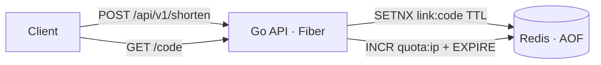

# url-shortener

Short links service in Go: [Fiber](https://gofiber.io) + Redis, packed into a ~10 MB distroless image.

- `POST /api/v1/shorten` creates a short link (random or custom code)
- `GET /<code>` redirects to the original URL
- links expire (24 h by default, capped by `MAX_EXPIRY_HOURS`)
- rate limit per client IP: `API_QUOTA` requests per `API_QUOTA_WINDOW_MIN`, `429` + `Retry-After` when exceeded
- `GET /health` checks the Redis connection (for Docker/Traefik healthchecks)
- graceful shutdown on SIGTERM; settings only from environment variables



## Run with Docker Compose

```bash
cp .env.example .env        # set REDIS_PASSWORD
docker compose up -d --build
```

```bash
curl -s localhost:3000/api/v1/shorten -H 'Content-Type: application/json' \
     -d '{"url":"go.dev/doc","code":"godoc","expiry_hours":48}'
# {"url":"https://go.dev/doc","short_url":"http://localhost:3000/godoc","expires_in_hours":48,"rate_remaining":9,"rate_reset_seconds":1800}

curl -i localhost:3000/godoc   # 302 Location: https://go.dev/doc
```

## API

| Field | Type | |
|---|---|---|
| `url` | string | required; `https://` is added if the scheme is missing; only http/https |
| `code` | string | optional custom code, 3–32 chars `[A-Za-z0-9_-]`; `409` if taken |
| `expiry_hours` | int | optional, default `DEFAULT_EXPIRY_HOURS` |

Errors are JSON: `{"error": "..."}` with `400`, `404`, `409`, `429` or `503`.

## Design notes

- `SETNX` makes code reservation atomic, so two clients can't get the same custom code.
- Random codes use `crypto/rand` and an alphabet without look-alike characters (`l`, `I`, `O`, `0`, `1`).
- Rate limit is a fixed window: `INCR` + `EXPIRE NX` in one transaction, no race between them.
- Links to the service's own `DOMAIN` are rejected to avoid redirect loops.
- Behind a reverse proxy set `TRUST_PROXY=true` so the limit uses the real client IP.

## Metrics

`GET /metrics` exposes Prometheus metrics: `http_requests_total`, `http_request_duration_seconds`,
`shortener_links_created_total`, `shortener_redirects_total`, `shortener_rate_limited_total`.
A Grafana dashboard is at `deploy/grafana/dashboard.json` and alert rules (high error rate, high
latency, target down) at `deploy/prometheus/rules.yml` — check them with
`promtool check rules deploy/prometheus/rules.yml`.

## Deploy with Helm

```bash
helm install url-shortener deploy/helm/url-shortener \
  --set redis.addr=redis:6379 \
  --set redis.existingSecret=redis-secret \
  --set redis.existingSecretKey=redis-password
```

Redis itself is external to the chart. See `deploy/helm/url-shortener/values.yaml` for the rest of
the settings (ingress, autoscaling, ServiceMonitor).

## Release

Pushing a tag `url-shortener/vX.Y.Z` builds and pushes a multi-arch (amd64/arm64) image to
`ghcr.io/vionarion/url-shortener`, then scans it with Trivy (SARIF uploaded to code scanning,
fails on CRITICAL findings).

## Development

```bash
go test -race -cover ./...   # tests run against in-memory Redis (miniredis), no Docker needed
```
