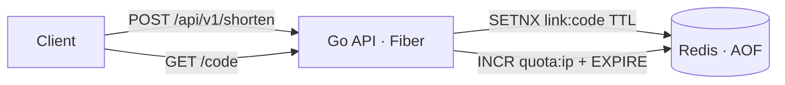

# url-shortener

Short links service in Go: [Fiber](https://gofiber.io) + Redis, packed into a ~10 MB distroless image.

- `POST /api/v1/shorten` creates a short link (random or custom code)
- `GET /<code>` redirects to the original URL
- links expire (24 h by default, capped by `MAX_EXPIRY_HOURS`)
- rate limit per client IP: `API_QUOTA` requests per `API_QUOTA_WINDOW_MIN`, `429` + `Retry-After` when exceeded
- `GET /health` checks the Redis connection (readiness, Docker/Traefik healthchecks);
  `GET /livez` only reports that the process is alive (liveness)
- graceful shutdown on SIGTERM; settings only from environment variables



## Run with Docker Compose

```bash
cp .env.example .env        # set REDIS_PASSWORD
docker compose up -d --build
```

```bash
curl -s localhost:3000/api/v1/shorten -H 'Content-Type: application/json' \
     -d '{"url":"go.dev/doc","code":"godoc","expiry_hours":48}'
# {"url":"https://go.dev/doc","short_url":"http://localhost:3000/godoc","expires_in_hours":48,"rate_remaining":9,"rate_reset_seconds":1800}

curl -i localhost:3000/godoc   # 302 Location: https://go.dev/doc
```

## API

| Field | Type | |
|---|---|---|
| `url` | string | required; `https://` is added if the scheme is missing; only http/https |
| `code` | string | optional custom code, 3–32 chars `[A-Za-z0-9_-]`; `409` if taken |
| `expiry_hours` | int | optional, default `DEFAULT_EXPIRY_HOURS` |

Errors are JSON: `{"error": "..."}` with `400`, `404`, `409`, `429` or `503`.

## Design notes

- `SETNX` makes code reservation atomic, so two clients can't get the same custom code.
- Random codes use `crypto/rand` and an alphabet without look-alike characters (`l`, `I`, `O`, `0`, `1`).
- Rate limit is a fixed window: `INCR` + `EXPIRE NX` in one transaction, no race between them.
- Links to the service's own `DOMAIN` are rejected to avoid redirect loops.
- Behind a reverse proxy set `TRUST_PROXY=true` so the limit uses the real client IP.

## Metrics

`GET /metrics` exposes Prometheus metrics: `http_requests_total`, `http_request_duration_seconds`,
`shortener_links_created_total`, `shortener_redirects_total`, `shortener_rate_limited_total`.
A Grafana dashboard is at `deploy/grafana/dashboard.json` and alert rules (high error rate, high
latency, target down) at `deploy/prometheus/rules.yml` — check them with
`promtool check rules deploy/prometheus/rules.yml`.

## Deploy with Helm

```bash
helm install url-shortener deploy/helm/url-shortener \
  --set redis.addr=redis:6379 \
  --set redis.existingSecret=redis-secret \
  --set redis.existingSecretKey=redis-password
```

Redis itself is external to the chart; `deploy/redis/redis.yaml` is a single-instance StatefulSet
with AOF on a persistent volume. See `deploy/helm/url-shortener/values.yaml` for the rest of
the settings (ingress, autoscaling, spread across nodes, ServiceMonitor).

## Secrets: Vault

The Redis password lives in HashiCorp Vault (HA, Raft, TLS) on the same cluster and is synced
into the `redis` Secret by Vault Secrets Operator using Kubernetes auth and a read-only policy.
Rotation does not restart Redis and was measured at 0 errors of 180k requests under load;
the first naive version gave ~12k `503`s. Setup, design choices and the failover test:
[`deploy/vault`](deploy/vault/README.md).

## Load test

Measured on a 3-node k3s v1.36 cluster (1× 4 vCPU/8 GB, 2× 2 vCPU/8 GB VMs), chart installed with
default values, a single Redis 8 pod with AOF, [hey](https://github.com/rakyll/hey) run from the
control-plane node against the ClusterIP service, 100 connections (50 for `POST`).

| Scenario | Pods | CPU limit | Requests/s | p50 | p90 | p99 | Errors |
|---|---|---|---|---|---|---|---|
| `GET /:code` (302), 120 s, HPA scaling 2→6 | 2→6 | 200m | 6 538 | 2.5 ms | 85 ms | 91 ms | 0 |
| `POST /api/v1/shorten`, 60 s | 6 | 200m | 9 240 | 1.0 ms | 2.8 ms | 85 ms | 0 |
| `GET /:code` (302), 60 s | 6 | 200m | 17 630 | 0.9 ms | 2.9 ms | 87 ms | 0 |
| `GET /:code` (302), 60 s | 6 | 1 | 38 138 | 2.1 ms | 5.2 ms | 9.4 ms | 0 |

Takeaways:

- The HPA scaled the deployment from 2 to the maximum of 6 replicas within the first minute.
- With a 200m CPU limit the latency is bimodal: most requests take 1–3 ms, but ~10% wait ~85–90 ms.
  That is CFS throttling — a pod uses its 20 ms of CPU per 100 ms period and then waits for the next
  period. Raising the limit to 1 CPU doubled throughput and cut p99 from 87 ms to 9 ms, so the chart
  default is now `limits.cpu: 1`.
- 555k links took 73 MB of Redis memory (~130 bytes per link); each app pod stayed under 12 MiB.

## Failure test

Same cluster, steady load of ~2 000 req/s (`GET /:code`, 100 connections, 2 s client timeout),
6 replicas. Each failure was injected in the middle of the run; the node failure is a network
partition of one worker (nftables drop to/from the other nodes, reverted after 150 s).

| Failure | Before | After |
|---|---|---|
| Rolling update (`rollout restart`) | 22 `connection refused` of 180k | **0 errors** |
| Redis pod restarted | every link lost: 100% of redirects → `404` | links kept, 126 timeouts during the ~2 s restart |
| Redis down for 60 s | 17 app restarts, 2 pods in `CrashLoopBackOff`, back ~15 s after Redis, links lost | **0 restarts**, back within 2 s after Redis, links kept |
| One of 3 nodes cut off | 28 timeouts of ~400k (2 of 6 pods on the node) | 42 timeouts of ~400k; with the old placement (3+3+0 pods) 56 |

What was wrong and what changed:

- **Rolling update.** The pod got SIGTERM while kube-proxy on other nodes still sent it new
  connections. Fix: `preStop: sleep 5` (native sleep action, works in a distroless image) — the pod
  keeps serving until the endpoint removal has propagated.
- **Liveness tied to Redis.** The liveness probe used `/health`, which pings Redis, so a Redis outage
  made Kubernetes restart every app pod, and the app exited at start-up when Redis was unreachable →
  `CrashLoopBackOff` with growing back-off that outlived the outage. Fix: liveness → `/livez`
  (process only), readiness stays on `/health`; the app no longer exits when Redis is down at start.
- **Redis without a volume.** AOF was enabled but written to the container filesystem, so a new pod
  started empty. Fix: StatefulSet with a PVC (`deploy/redis/redis.yaml`).
- **Uneven placement.** `ScheduleAnyway` spread still produced 3+3+0 pods, so one node held half the
  capacity. Fix: `DoNotSchedule` with `nodeTaintsPolicy: Honor` (a NotReady node does not block
  scheduling) and `matchLabelKeys: [pod-template-hash]` (old pods of a rolling update are not counted;
  without it the result was 2+1+3). Now 2+2+2. Spread is only applied at scheduling, so an HPA
  scale-down can still leave it uneven until the next rollout.
- **Node failure** is bounded by detection: the node turned `NotReady` after ~40 s and only then were
  its pods removed from the Service. Requests that hit them in that window time out; this needs
  retries at the client or ingress level, not an app change.

## Release

Pushing a tag `url-shortener/vX.Y.Z` builds and pushes a multi-arch (amd64/arm64) image to
`ghcr.io/vionarion/url-shortener`, then:

1. generates an SBOM (SPDX) with Syft;
2. signs the image by digest with cosign keyless signing (GitHub Actions OIDC identity, recorded in
   the Sigstore transparency log) and attaches the SBOM as a signed attestation;
3. scans it with Trivy (SARIF uploaded to code scanning, fails on CRITICAL findings).

Verify a release by hand:

```bash
cosign verify ghcr.io/vionarion/url-shortener:1.0.0 \
  --certificate-oidc-issuer https://token.actions.githubusercontent.com \
  --certificate-identity-regexp '^https://github.com/vionarion/go-projects/.github/workflows/release.yml@refs/tags/url-shortener/v'
```

## Supply chain security

| Stage | Check | Fails the build on |
|---|---|---|
| Every push | `govulncheck` | known vulnerabilities in code paths the app actually calls |
| Every push | `gosec` | insecure code patterns (missing HTTP timeouts, weak randomness, etc.) |
| Every push | `trivy config` | HIGH/CRITICAL misconfigurations in the Dockerfile and Helm chart |
| Every push | `trivy image` | fixable HIGH/CRITICAL vulnerabilities in the built image |
| Every push | `gitleaks` | committed secrets |
| Release | Syft + cosign | — produces the SBOM and the signature |
| Cluster | Kyverno | pods with an unsigned image or one signed by anyone else |

`deploy/policy/verify-image-signature.yaml` is a Kyverno `ImageValidatingPolicy`: the cluster only
admits `ghcr.io/vionarion/url-shortener` images signed by this repository's release workflow from a
`url-shortener/v*` tag. Tested on k3s with Kyverno 1.19: a pod with an unsigned image is denied at
admission, while other images are not affected. If the GHCR package is private, add registry
credentials to the policy (`spec.credentials`).

## Development

```bash
go test -race -cover ./...   # tests run against in-memory Redis (miniredis), no Docker needed
```
