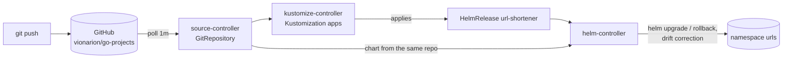

# Flux GitOps for url-shortener

Flux v2.9 on the same 3-node k3s lab. Git is the only way to change the release: a push to the
tracked branch reaches the cluster in about a minute, manual edits are reverted, and a broken
release is rolled back automatically.



| File | What it does |
|---|---|
| `clusters/lab/source.yaml` | `GitRepository`: public repo, polled every minute, only `url-shortener/deploy/` is fetched |
| `clusters/lab/apps.yaml` | `Kustomization`: applies `apps/`, `prune: true`, waits for health |
| `apps/url-shortener/helmrelease.yaml` | `HelmRelease`: chart from git, values, `driftDetection: enabled`, upgrade remediation = rollback |

Redis (`deploy/redis`) and the Redis password (`deploy/vault`, Vault Secrets Operator) are not part
of this release on purpose: data and secrets have their own lifecycle.

## Install (lab)

```bash
flux install --export > flux.yaml && kubectl apply -f flux.yaml
# the lab has no direct internet: only source-controller needs the egress proxy
kubectl -n flux-system set env deploy/source-controller HTTPS_PROXY=http://<proxy>:8888 \
  NO_PROXY=127.0.0.0/8,10.0.0.0/8,192.168.0.0/16,.svc,.cluster.local,localhost
kubectl apply -f clusters/lab/
```

The existing Helm release `urls` was adopted without downtime (`releaseName: urls`).

## Test results (2026-10-23)

| Test | What happened |
|---|---|
| Change in git (`autoscaling.minReplicas` 2 → 3) | in the cluster 73 s after `git push` (1 m poll interval) |
| Manual drift: Service deleted, HPA `minReplicas` set to 1 by hand | `DriftDetected` → `DriftCorrected` on the next reconcile, both restored |
| Broken release (image tag that does not exist) | Helm wait timed out (2 m), Flux rolled back to the previous revision; 16 000 requests during the test, all 200; then `git revert` made git match the cluster again |

## Lessons

- **HPA owns `replicas`.** With autoscaling enabled the chart does not render `replicas`, so
  `replicaCount` in git does nothing; the knob in git is `autoscaling.minReplicas/maxReplicas`.
- **Topology spread is checked only at scheduling time.** After an HPA scale-down from 6 to 2 both
  remaining pods were on one node (2-0-0). New pods follow the rule; fixing the existing skew needs
  the descheduler (`RemovePodsViolatingTopologySpreadConstraint`) or a rollout.
- **Proxy only where it is needed.** With `HTTP_PROXY` on every controller, kustomize-controller
  tried to download the artifact from source-controller through the proxy and hung; in-cluster
  traffic must not go through it.
- **Rollback is not the end.** After the automatic rollback git still says "broken", Flux retries and
  stalls; the fix is a `git revert`, so git and the cluster agree again.
