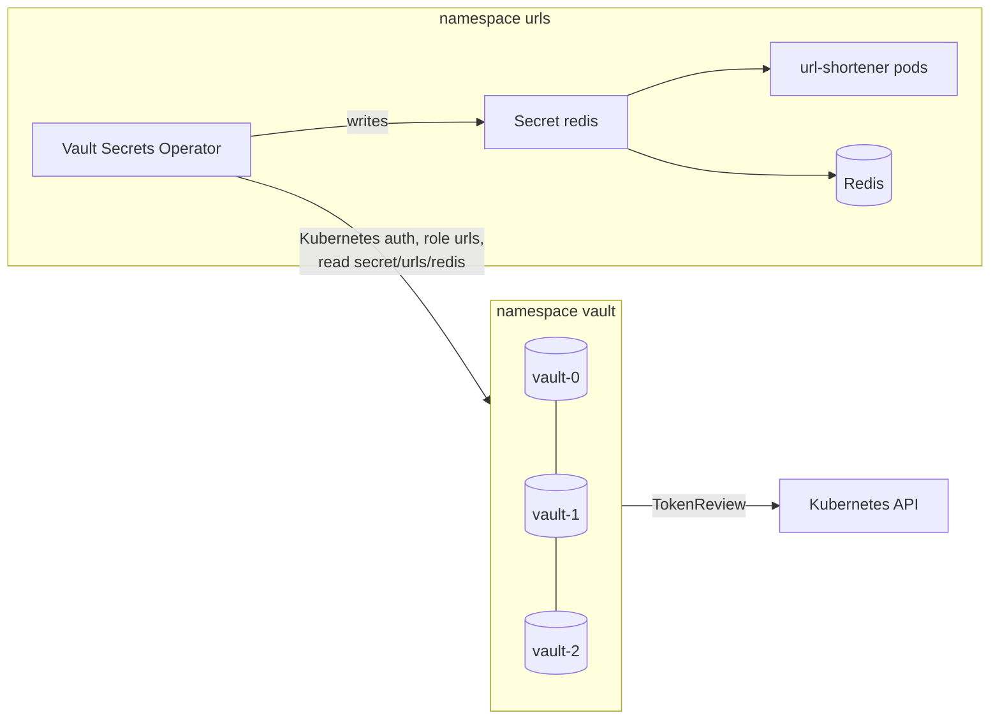

# Vault for url-shortener

HashiCorp Vault 2.0 in HA mode on the same 3-node k3s cluster. The Redis password is generated
inside Vault and reaches Redis and the app through Vault Secrets Operator (VSO); nobody types it
and it is not stored in git or Helm values.



| Piece | Choice | Why |
|---|---|---|
| Storage | integrated Raft, 3 voters, PVC per pod, one pod per node | no external Consul/DB; survives the loss of one node |
| Transport | TLS on the API and between Raft peers, private CA (`tls.sh`) | secrets never cross the network in clear text |
| Unseal | Shamir 5 shares / threshold 3 (`init.sh`) | lab only; production: auto-unseal with cloud KMS (AWS KMS / Alibaba KMS) |
| Apps get secrets | VSO → Kubernetes Secret | the app keeps reading an env var; works while Vault is down (the Secret stays) |
| Auth | Kubernetes auth, role `urls` bound to SA `urls/vault-auth`, audience `vault` | no static Vault tokens in the cluster |
| Policy | `read` on `secret/data/urls/redis` only | least privilege |
| Audit | file audit device on its own PVC | every request is logged (values HMAC-ed) |

Trade-off: a synced Kubernetes Secret lives in etcd. Mitigations: etcd encryption at rest
(k3s `--secrets-encryption`), RBAC on Secrets. The alternative without that copy is the Vault
Agent sidecar or the CSI provider; then the app has to read the secret from a file.

## Install

Charts `hashicorp/vault` 0.34.1 and `hashicorp/vault-secrets-operator` 1.6.2.
(`releases.hashicorp.com` answers 403 to Russian IPs, so the charts were downloaded elsewhere
and copied; images come from Docker Hub.)

```bash
./tls.sh                                   # CA + server cert -> Secret vault/vault-tls, CA -> urls/vault-ca
helm install vault hashicorp/vault --version 0.34.1 -n vault -f values-vault.yaml
helm install vso hashicorp/vault-secrets-operator --version 1.6.2 \
  -n vault-secrets-operator --create-namespace -f values-vso.yaml
./init.sh                                  # init once, unseal 3 pods, show Raft peers
./configure.sh                             # audit, KV v2, Kubernetes auth, policy, role, Redis password
kubectl apply -f secrets.yaml              # VaultConnection, VaultAuth, VaultStaticSecret
```

`init.sh` and `configure.sh` are idempotent. `vault-init.json` (unseal keys, root token) and
`pki/` are git-ignored.

## Password rotation

```bash
./rotate.sh     # new random password, the old one kept as "previous"
```

VSO picks the change up within `refreshAfter` (30 s), updates Secret `redis` and restarts the
url-shortener Deployment. Redis is not restarted: a sidecar in the Redis pod applies
`ACL SETUSER default >current >previous` to the running server, so pods with the old and the new
password both work during the rollout.

Measured under ~1 000 req/s (`GET /:code`, 6 replicas):

| Rotation | Errors |
|---|---|
| First version: VSO restarts Redis and the app | 11 964 `503` of 146k in a ~15 s window (old pods still had the old password) |
| Redis accepts current + previous, only the app restarts | **0 of 180k** |

New app pods stay not-ready until Redis has the new password (kubelet refreshes Secret volumes
within about a minute), so the rolling update simply waits — old pods keep serving.

## Failover

Deleting the active Vault pod: a standby became active after **~6 s**, reads worked through it.
The restarted pod came back **sealed** and stayed not-ready until `init.sh` unsealed it — with
Shamir unsealing every Vault restart needs people with key shares, which is the main argument
for KMS auto-unseal in production. The app was not affected: it reads the synced Secret,
not Vault.
